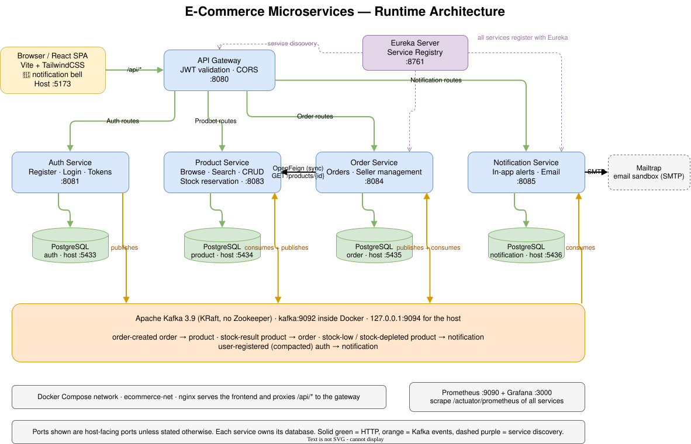

# E-Commerce Microservices Platform

A full-stack e-commerce platform built with Spring Boot 4 + React, featuring
6 backend microservices with service discovery, API gateway, JWT auth,
role-based access control and event-driven communication over Apache Kafka.
Fully dockerized.

---

## 🏗️ Architecture



---

## 🧩 Services

| Service                  | Port | Purpose                                                                 | DB                          |
| ------------------------ | ---- | ----------------------------------------------------------------------- | --------------------------- |
| **eureka-server**        | 8761 | Service registry                                                        | —                           |
| **api-gateway**          | 8080 | Edge routing + JWT validation + CORS                                    | —                           |
| **auth-service**         | 8081 | Register, login, JWT issue/refresh, email confirmation                  | postgres-auth :5433         |
| **product-service**      | 8083 | Product CRUD (SELLER), browse/search (all), stock reservation via Kafka | postgres-product :5434      |
| **order-service**        | 8084 | Order placement, order history, seller order management                 | postgres-order :5435        |
| **notification-service** | 8085 | Seller stock alerts: in-app notifications + Mailtrap email              | postgres-notification :5436 |
| **kafka**                | 9094 | Event broker, KRaft mode (host port bound to 127.0.0.1)                 | —                           |
| **frontend**             | 5173 | React SPA (auth, products, cart, orders, notification bell)             | —                           |

---

## 🔐 Security Model

**JWT validated at the API Gateway** (single point of auth).

Flow:

1. Browser → Gateway with `Authorization: Bearer <JWT>`
2. Gateway's `JwtAuthFilter`:
   - Skips public paths: `/api/auth/register`, `/login`, `/confirm`, `/refresh`, `/logout`
   - Validates JWT signature (HS256)
   - Extracts `userId` and `role`
   - **Strips** any incoming `X-User-Id` / `X-User-Role` headers (prevents spoofing)
   - Adds trusted `X-User-Id` and `X-User-Role` headers
3. Downstream services trust these headers (via `HeaderAuthFilter` → Spring Security context)
4. `@PreAuthorize("hasRole('SELLER')")` etc. enforced at service level
5. notification-service requires the gateway headers already in its `SecurityFilterChain`
   (`anyRequest().authenticated()` → 403). Known gap: order-service and product-service use
   `permitAll()` + `@PreAuthorize` with required `@RequestHeader`s, so a request without
   headers can end in 500 instead of 403 (the header is read before the role check).

**Roles:** CUSTOMER, SELLER, ADMIN

**Registration flow:**

1. POST /auth/register → save user (enabled=false) → send confirmation email (Mailtrap)
2. User clicks confirmation link → POST /auth/confirm → enabled=true → `user-registered` published to Kafka (after commit)
3. Only enabled users can log in

**Token flow:**

- Access token: 15 min (dev: 1h via `application-local.yaml` override)
- Refresh token: 7 days
- Access token in memory (React state)
- Refresh token in localStorage
- Axios interceptor auto-refreshes on 401

---

## 🗄️ Data Model

**Per-service PostgreSQL** (database-per-service pattern).

### auth-service

- `users` (id, email UNIQUE, password BCrypt, role, enabled, created_at, updated_at)
- `confirmation_tokens` (id, token, user_id, expires_at, confirmed_at, created_at)
- `refresh_tokens` (id, token, user_id, expires_at, revoked, created_at)

### product-service

- `products` (id, name, description, price, stock, category, image_url, seller_id, active, timestamps)
- **Soft delete**: `active=false` instead of physical delete
- All reads filter `active=true`
- Composite index on (seller_id, product_id) for seller-order queries
- `processed_event` (event_id PK, processed_at): idempotency for consumed `order-created` events (Flyway V2)

### order-service

- `orders` (id, customer_id, total_price, status, timestamps)
- `order_items` (id, order_id FK, product_id, product_name, product_image, seller_id, unit_price, quantity, subtotal)
- **Snapshot pattern**: order items store product data at order time (name, price, image) — preserved if product changes later

**Order status state machine:**

PENDING → CONFIRMED → SHIPPED → DELIVERED

Only seller can transition. Invalid transitions return 400.
PENDING → CANCELLED happens automatically when product-service rejects the stock
reservation (`stock-result` with reserved=false).

### notification-service

- `processed_event` (event_id PK, processed_at): idempotency for stock events (V1)
- `notifications` (id, user_id, type STOCK_LOW/STOCK_DEPLETED, title, message, product_id, is_read, created_at), index (user_id, is_read) (V2)
- `user_contact` (user_id PK = auth user id, email, role, updated_at): local address book from `user-registered` (V3).
  Users confirmed before Step 9d are not in it (no backfill), so they get in-app alerts only.

---

## 🔌 Inter-Service Communication

**Synchronous (OpenFeign + Apache HC5):** only `order-service` → `product-service`
`GET /products/{id}` to validate price and stock while building the order.
`FeignConfig` forwards `X-User-Id` / `X-User-Role`.

**Asynchronous (Apache Kafka 3.9, KRaft, single broker):**

| Topic             | Producer → Consumer                    | Key       | Purpose                                                  |
| ----------------- | -------------------------------------- | --------- | -------------------------------------------------------- |
| `order-created`   | order-service → product-service        | orderId   | Reserve stock for a saved PENDING order                  |
| `stock-result`    | product-service → order-service        | orderId   | reserved true/false + reason; rejected → order CANCELLED |
| `stock-low`       | product-service → notification-service | productId | Stock crossed above 3 → 1..3 (once per crossing)         |
| `stock-depleted`  | product-service → notification-service | productId | Stock reached 0                                          |
| `user-registered` | auth-service → notification-service    | userId    | Confirmed user contact (compacted topic = address book)  |

Patterns: publish after DB commit (`@TransactionalEventListener(AFTER_COMMIT)`),
idempotent consumers (`processed_event` table), all-or-nothing stock
reservation, keys for per-entity ordering, consumers validate every event
(e.g. quantity > 0), Kafka external listener bound to 127.0.0.1.

Known gaps (planned): no retry/dead-letter topic yet (Step 10); Kafka has no
SASL/ACLs (network isolation only); if a send fails after commit the event is
lost (outbox pattern would fix this).

---

## 🖥️ Frontend

**Stack:** React 18 + Vite 8 + TailwindCSS 3 + React Router v6 + Axios

### Pages

| Route                       | Access   | Purpose                          |
| --------------------------- | -------- | -------------------------------- |
| `/`                         | public   | Home                             |
| `/register`                 | public   | Signup                           |
| `/login`                    | public   | Login (supports `?returnTo=`)    |
| `/confirm?token=`           | public   | Auto-confirm email               |
| `/products`                 | public   | Browse + search                  |
| `/products/:id`             | public   | Detail + Add to Cart             |
| `/cart`                     | public   | Shopping cart (localStorage)     |
| `/checkout`                 | CUSTOMER | Place order                      |
| `/orders/mine`              | CUSTOMER | Order history                    |
| `/orders/:id`               | any auth | Order detail                     |
| `/seller/products`          | SELLER   | Manage own products              |
| `/seller/products/new`      | SELLER   | Add product                      |
| `/seller/products/:id/edit` | SELLER   | Edit product                     |
| `/seller/orders`            | SELLER   | Incoming orders + status updates |
| `/dashboard/customer`       | CUSTOMER | Customer dashboard               |
| `/dashboard/seller`         | SELLER   | Seller dashboard                 |
| `/dashboard/admin`          | ADMIN    | Admin dashboard                  |

### Key patterns

- **Guest cart** in localStorage (key: `ecommerce_cart`) — no login needed to add to cart
- **Login required at checkout** (with return-to-checkout flow)
- **ProtectedRoute** with optional `allowedRoles` prop
- **Axios interceptors**: attach JWT, auto-refresh on 401
- **Three axios instances** (auth, products, orders) sharing token via `setAccessToken()` calls from AuthContext

### Frontend API baseURL strategy

- **Dev mode**: `/api/*` proxied by Vite dev server → `http://localhost:8080`
- **Docker/production**: `/api/*` proxied by nginx → `http://api-gateway:8080`

---

## 🐳 Docker Setup

**Single command runs everything:** `docker compose up -d`

### Containers

- 4 Postgres instances (auth, product, order, notification)
- 6 Spring Boot services (multi-stage Dockerfiles: JDK build → JRE runtime)
- 1 Kafka broker (apache/kafka 3.9, KRaft mode, `kafka_data` volume)
- 1 nginx-served React frontend
- 1 Prometheus (metrics scraper, TSDB)
- 1 Grafana (dashboards, provisioned datasource)

### Configuration

- Secrets passed via **environment variables** (never baked into images)
- `SPRING_PROFILES_ACTIVE=""` prevents `application-local.yaml` from loading in containers
- **JWT_SECRET must be identical** between `api-gateway` and `auth-service`
- Mail credentials (`MAILTRAP_USERNAME`, `MAILTRAP_PASSWORD`) on auth-service and notification-service
- Kafka clients use `SPRING_KAFKA_BOOTSTRAP_SERVERS=kafka:9092` in containers, `localhost:9094` from the IDE

### Ports (host ↔ container)

| Service               | Host           | Container |
| --------------------- | -------------- | --------- |
| frontend              | 5173           | 80        |
| api-gateway           | 8080           | 8080      |
| auth-service          | 8081           | 8081      |
| product-service       | 8083           | 8083      |
| order-service         | 8084           | 8084      |
| notification-service  | 8085           | 8085      |
| eureka-server         | 8761           | 8761      |
| kafka (EXTERNAL)      | 127.0.0.1:9094 | 9094      |
| postgres-auth         | 5433           | 5432      |
| postgres-product      | 5434           | 5432      |
| postgres-order        | 5435           | 5432      |
| postgres-notification | 5436           | 5432      |

---

## 🛠️ Tech Stack Summary

**Backend:**

- Java 21, Spring Boot 4.1.1, Spring Cloud 2025.1.3
- Spring Security 6 (JWT, BCrypt, role-based)
- Spring Data JPA, Hibernate
- Flyway (migrations)
- MapStruct (DTO mapping)
- OpenFeign + Apache HC5 (inter-service calls)
- JJWT 0.12.6
- PostgreSQL 16
- Lombok

**Frontend:**

- React 18, Vite 8
- React Router v6
- Axios (with interceptors)
- TailwindCSS 3
- Context API (AuthContext, CartContext)

**Infrastructure:**

- Docker + Docker Compose
- Eureka (service discovery)
- Nginx (frontend serving + API proxy)
- Prometheus + Micrometer (metrics collection)
- Grafana (dashboards & visualization)

---

## 📌 Dev Setup

### Run everything in Docker (recommended)

```bash
docker compose up -d
```

### Frontend: seller token-expiry redirect leaves stale navbar (RESOLVED)

**Status:** Fixed in commit `45b1464` (fix(frontend): consolidate axios instances so refresh works everywhere).

**Root cause:** Three duplicate axios instances existed — only `api/axios.js` had the refresh-on-401 interceptor. `ordersAxios.js` and `productsAxios.js` had empty interceptors, so any 401 on seller/product pages propagated to page-level catch blocks that called `navigate("/login")` without clearing AuthContext.user. Result: redirect to login while navbar still showed the previous user.

**Fix applied:**

- Deleted `ordersAxios.js` and `productsAxios.js` (byte-for-byte duplicates)
- Repointed `api/orders.js` and `api/products.js` at the shared `api/axios.js`
- Changed `axios.js` baseURL from `/api/auth` to `/api`; added `/auth` prefix to auth-service calls in `api/auth.js`
- Removed dead `setOrdersAccessToken` / `setProductsAccessToken` from `AuthContext.jsx`
- Removed 5 dead 401/403 catch blocks in seller pages
- Replaced the hard-reload `window.location.href` fallback with a `window.dispatchEvent(new Event("auth:cleared"))` event; AuthContext listens and clears user/token state

**Verified:** Login as seller → force-expire access token → open `/seller/my-products` → page loads normally (silent refresh, no redirect). Then delete `refreshToken` from localStorage → open same page → redirect to `/login` with clean navbar (no stale user shown).

## 🚀 CI/CD Pipeline

**GitHub Actions** (`.github/workflows/ci.yml`) runs on every push and PR to `main`:

| Job                          | Purpose                                                                                                                       | Runtime       |
| ---------------------------- | ----------------------------------------------------------------------------------------------------------------------------- | ------------- |
| `build-backend` (matrix × 6) | Compiles + runs unit tests for eureka-server, api-gateway, auth-service, product-service, order-service, notification-service | ~30s          |
| `build-frontend`             | `npm ci` + `vite build`                                                                                                       | ~15s (cached) |
| `notify`                     | Runs only on push to `main` after both above pass. Publishes `deployment-signal` artifact with the commit SHA.                | ~5s           |

**Continuous deployment** runs on the VM (`ubuntu73`) via a polling script + cron:

- Script: `/home/dkhal/ci-deploy.sh`
- Cron: `*/5 * * * * /home/dkhal/ci-deploy.sh >> /dev/null 2>&1`
- Logs: `/home/dkhal/auto-deploy.log`

**Logic:**

1. Query `https://api.github.com/repos/KhaldounDamach2/kh-ecommerce-microservices/actions/workflows/ci.yml/runs?branch=main&status=success&per_page=1` (public API, no token)
2. Extract `head_sha` from the latest successful run
3. Query `/commits/{sha}/check-runs` to confirm all checks are green
4. Compare with local `git rev-parse HEAD`
5. If different → `git fetch && git reset --hard origin/main && docker compose down && docker compose up -d --build`
6. If same → no-op

**Why polling instead of GitHub-to-VM SSH:**

- The VM is a local VirtualBox VM behind NAT (`10.0.2.15`)
- GitHub Actions runners can't reach it (no public IP, no tunnel)
- Polling from VM → GitHub sidesteps the NAT problem entirely
- Requires no SSH secrets, no Cloudflare Tunnel, no domain

**Tradeoffs:**

- Deployment latency: up to 5 minutes (cron interval)
- Recreate deployment (short downtime during rebuild) — not blue-green

**Next step (future):** Blue-green deployment with two parallel stacks + nginx switch for zero-downtime.
