# 🛒 E-Commerce Microservices Platform

A production-shaped e-commerce platform built with **Spring Boot 4 + Spring Cloud + React 18**, featuring 6 microservices with service discovery, API gateway, JWT authentication, role-based access control, **event-driven communication with Apache Kafka**, and full Docker orchestration.


-231f20>)

[](https://github.com/KhaldounDamach2/kh-ecommerce-microservices/actions/workflows/ci.yml)

---

## 📸 Screenshots

### Customer Flow

| Home                                  | Products                                      | Product Detail                                     |
| ------------------------------------- | --------------------------------------------- | -------------------------------------------------- |
| 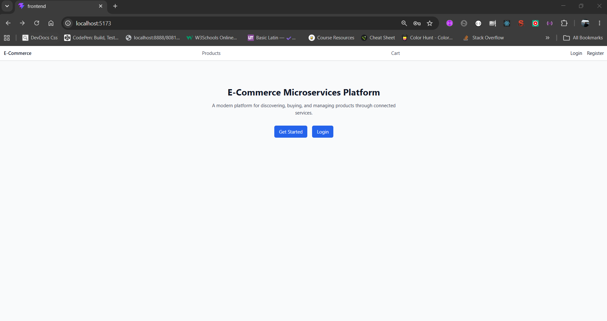 | 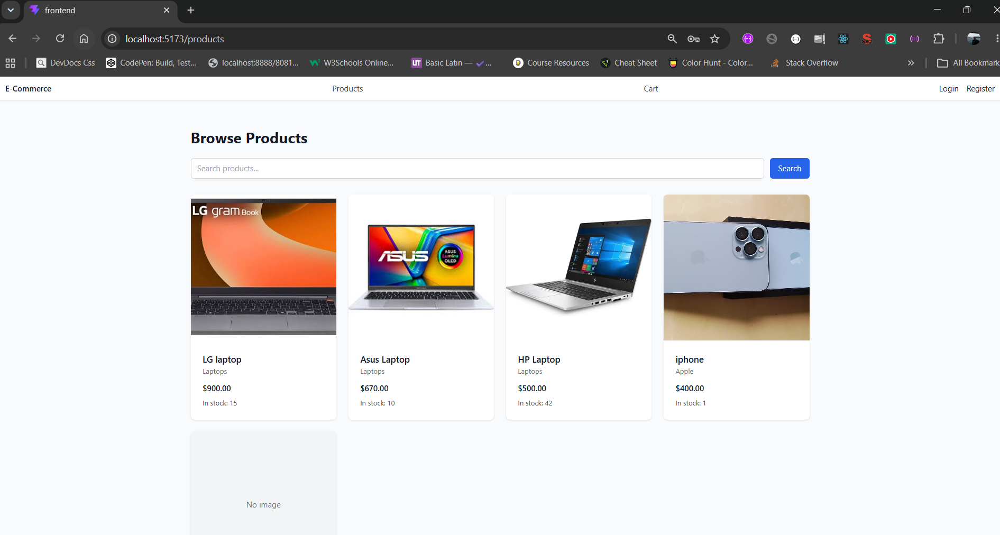 | 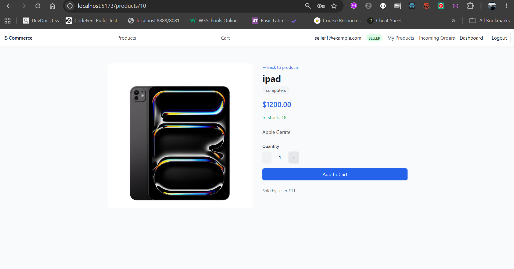 |

| Cart                                  | Checkout                                      | My Orders                                    |
| ------------------------------------- | --------------------------------------------- | -------------------------------------------- |
| 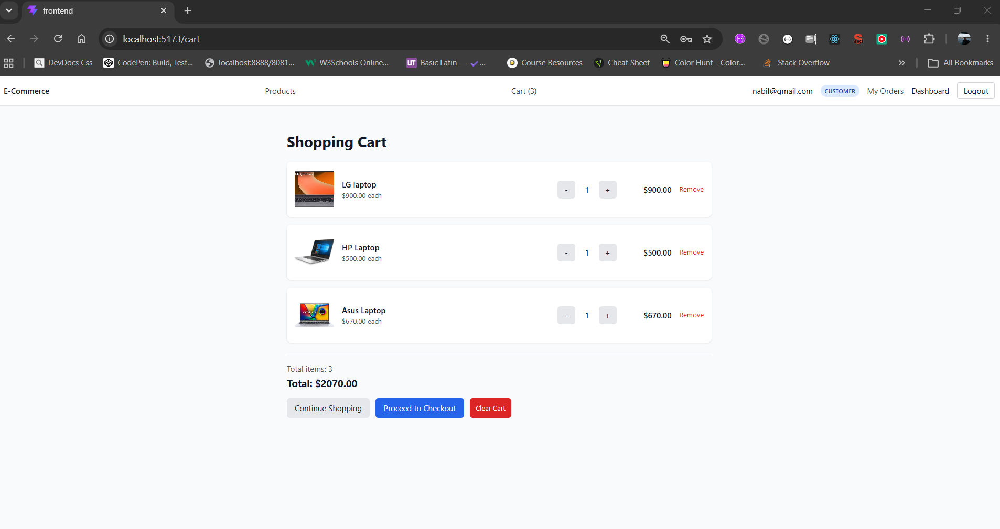 | 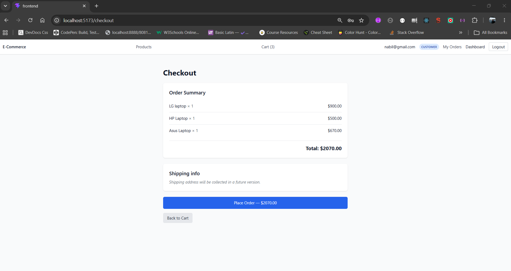 | 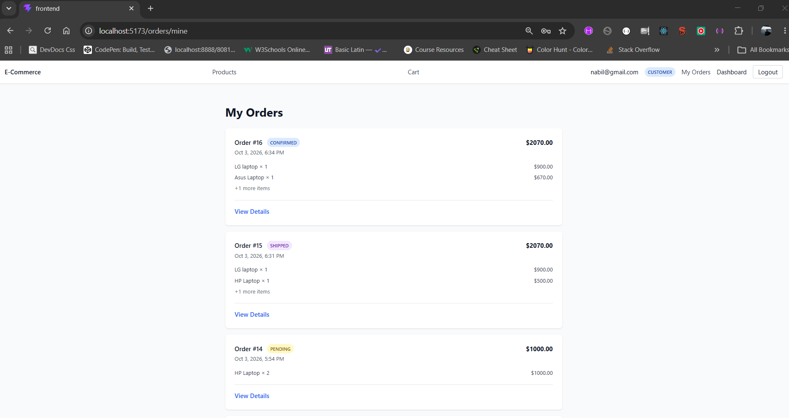 |

### Seller Flow

| Seller Products                                    | Product Edit                                  | Order Details                                   |
| -------------------------------------------------- | --------------------------------------------- | ----------------------------------------------- |
| 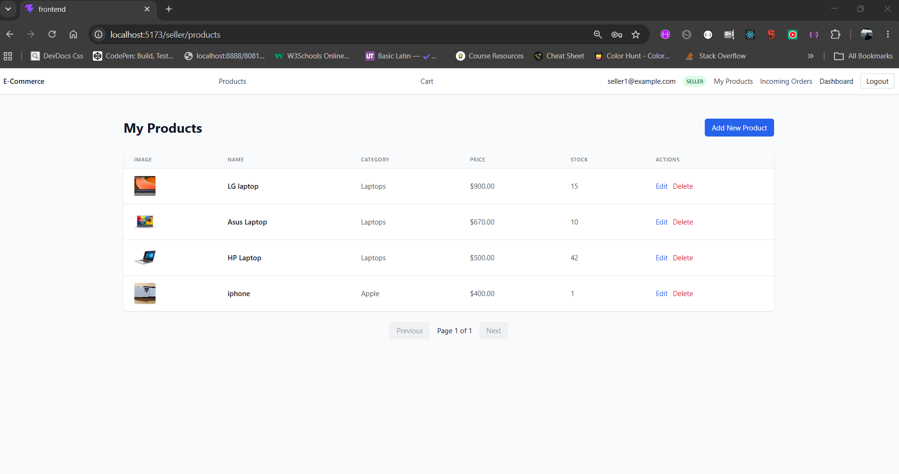 | 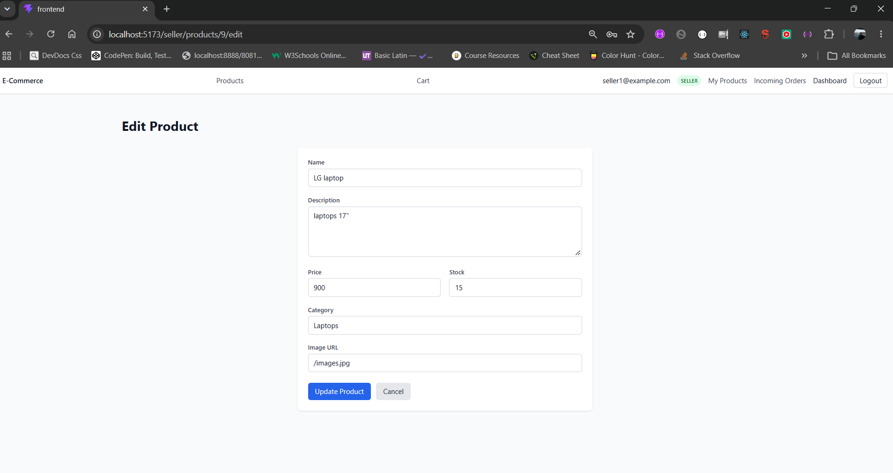 | 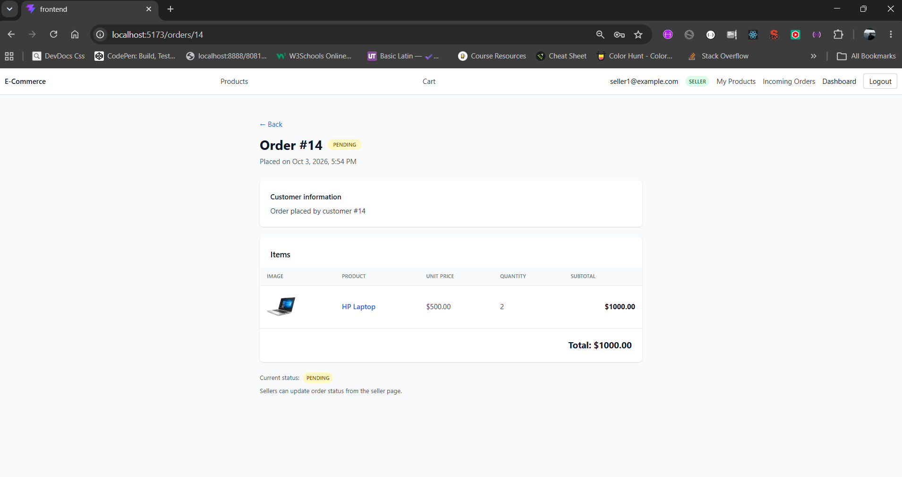 |

| Product Status                                           | Stock Alerts (Kafka → notification-service)             |     |
| -------------------------------------------------------- | ------------------------------------------------------- | --- |
| 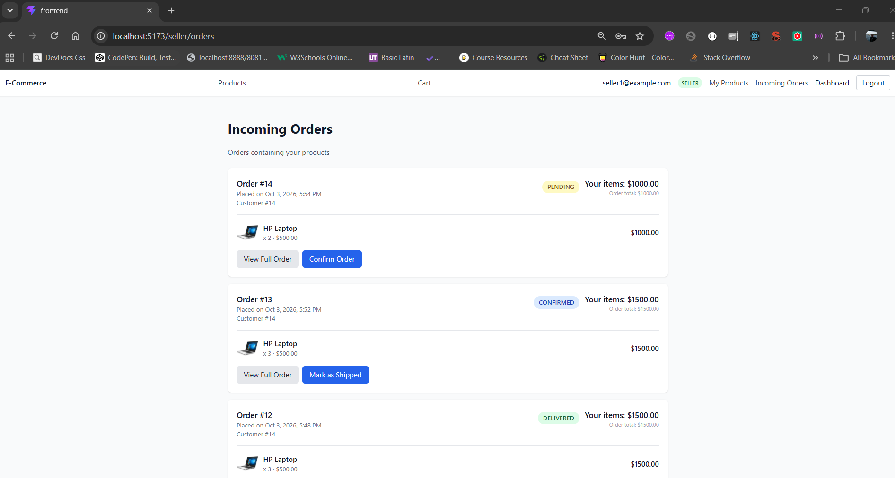 | 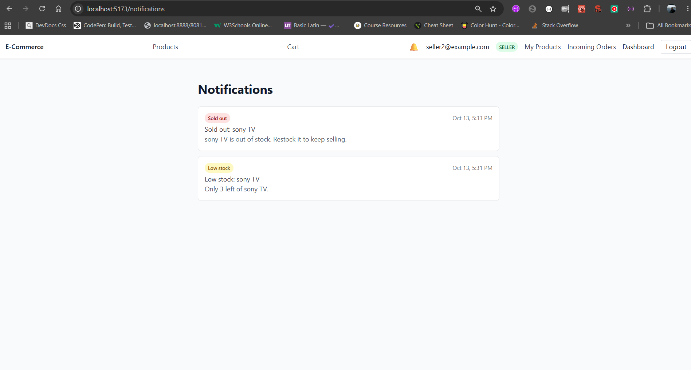 |     |

### Infrastructure & Observability

| Eureka Dashboard                          | Grafana (JVM Metrics)                                 | Prometheus Targets                                        |
| ----------------------------------------- | ----------------------------------------------------- | --------------------------------------------------------- |
| 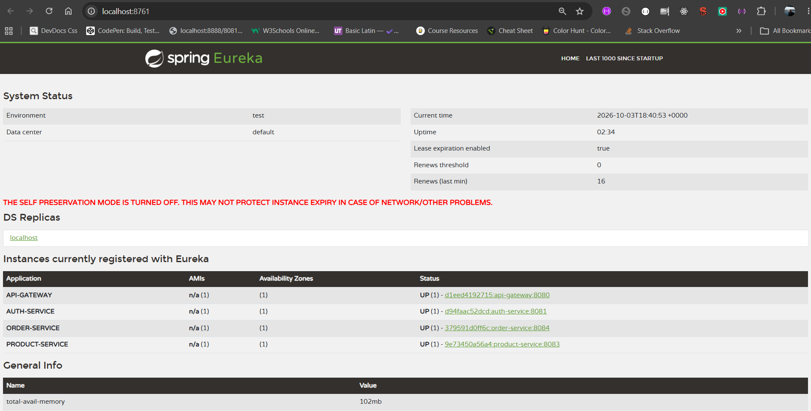 | 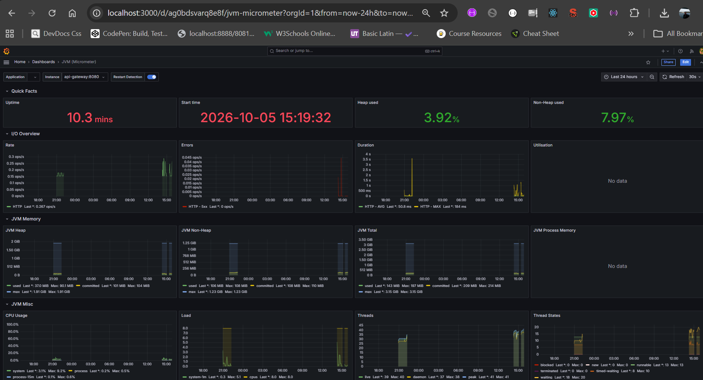 | 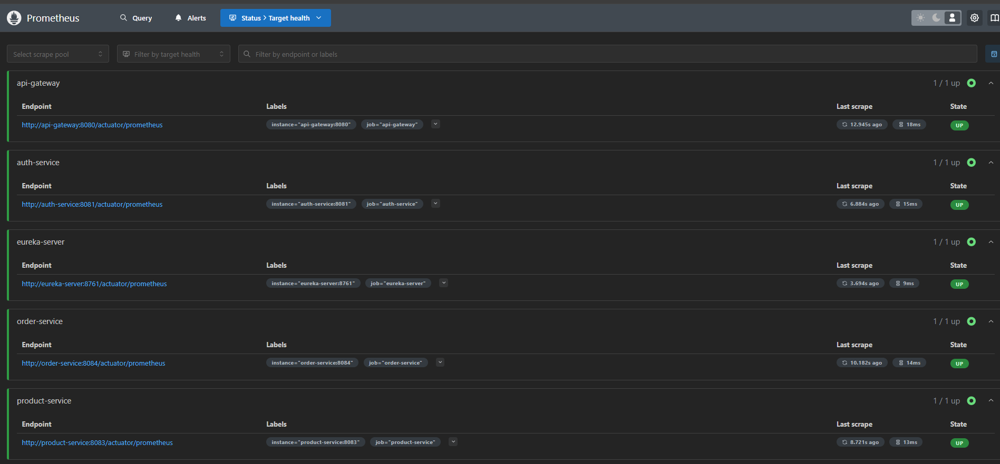 |

| GitHub Actions CI                          |     |     |
| ------------------------------------------ | --- | --- |
| 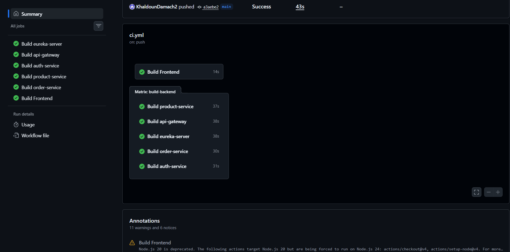 |     |     |

---

## 🏗️ Architecture


**6 Spring Boot services** behind an **API Gateway**, all registered with **Eureka** for service discovery. Each service owns its own **PostgreSQL** database (database-per-service pattern). Services talk to each other through **Apache Kafka** events (see [Event-Driven Communication](#-event-driven-communication-apache-kafka)). The frontend is a React SPA served by nginx, which proxies `/api/*` to the gateway.

| Service                  | Port | Purpose                                                                 | Database                    |
| ------------------------ | ---- | ----------------------------------------------------------------------- | --------------------------- |
| **eureka-server**        | 8761 | Service registry                                                        | —                           |
| **api-gateway**          | 8080 | Edge routing, JWT validation, CORS                                      | —                           |
| **auth-service**         | 8081 | Register, login, JWT issue/refresh, email confirmation                  | postgres-auth :5433         |
| **product-service**      | 8083 | Product CRUD (SELLER), browse/search (all), stock reservation via Kafka | postgres-product :5434      |
| **order-service**        | 8084 | Order placement, history, seller management                             | postgres-order :5435        |
| **notification-service** | 8085 | Stock alerts for sellers: in-app notifications + email                  | postgres-notification :5436 |
| **kafka**                | 9094 | Event broker (KRaft mode, no Zookeeper); host port bound to 127.0.0.1   | —                           |
| **frontend**             | 5173 | React SPA                                                               | —                           |
| **prometheus**           | 9090 | Metrics collection & time-series storage                                | —                           |
| **grafana**              | 3000 | Metrics visualization & dashboards                                      | —                           |

---

## 🚀 Quick Start

### Prerequisites

Docker Desktop (or Docker + Docker Compose) with about **6 GB of RAM** available for Docker.

### Run the entire stack

```bash
git clone https://github.com/KhaldounDamach2/kh-ecommerce-microservices.git
cd kh-ecommerce-microservices
cp .env.example .env
# edit .env first (see the note below)
docker compose up -d
```

> **Before `docker compose up`:** set your own values in `.env`:
>
> - `JWT_SECRET` must be **at least 32 characters** (HS256), otherwise auth-service and the gateway will not start.
> - Registration sends a confirmation email: put your **Mailtrap** sandbox credentials (or your own SMTP account) in `MAILTRAP_USERNAME` / `MAILTRAP_PASSWORD`.

The first start builds all 7 images (Maven downloads included), which takes about **10–20 minutes**; later starts reuse the cached images. The stack has 14 containers, and the Java services need 2–3 minutes until `docker compose ps` shows them all as **healthy**. Then:

| Service                | URL                                                                  |
| ---------------------- | -------------------------------------------------------------------- |
| 🖥️ Frontend            | http://localhost:5173                                                |
| 📋 Eureka Dashboard    | http://localhost:8761                                                |
| 🔌 API Gateway         | http://localhost:8080/api                                            |
| 📊 Prometheus          | http://localhost:9090                                                |
| 📈 Grafana             | http://localhost:3000 (admin / `GRAFANA_ADMIN_PASSWORD` from `.env`) |
| ❤️ Auth Health         | http://localhost:8081/actuator/health                                |
| ❤️ Product Health      | http://localhost:8083/actuator/health                                |
| ❤️ Order Health        | http://localhost:8084/actuator/health                                |
| ❤️ Notification Health | http://localhost:8085/actuator/health                                |

### Watch the Kafka events live

```bash
docker exec -it kafka /opt/kafka/bin/kafka-console-consumer.sh \
  --bootstrap-server localhost:9092 --topic stock-result --from-beginning --property print.key=true
```

Place an order in the frontend and the stock-reservation reply appears in the terminal. The same works for `order-created`, `stock-low`, `stock-depleted` and `user-registered`.

### Stop

```bash
docker compose down
```

### Stop and delete data

```bash
docker compose down -v
```

---

## 📊 Monitoring

Prometheus scrapes metrics from all 6 Spring Boot services; Grafana visualizes them.

| Component      | Purpose                                                             | URL                   |
| -------------- | ------------------------------------------------------------------- | --------------------- |
| **Prometheus** | Metrics collection, time-series storage (15s scrape, 15d retention) | http://localhost:9090 |
| **Grafana**    | Dashboards & visualization (provisioned Prometheus datasource)      | http://localhost:3000 |

Every service exposes `/actuator/prometheus` via Micrometer. Prometheus discovers targets by Docker container name.

**Recommended dashboard:** import Grafana dashboard ID `4701` (JVM Micrometer) via Dashboards → New → Import.

---

## 🚀 CI/CD

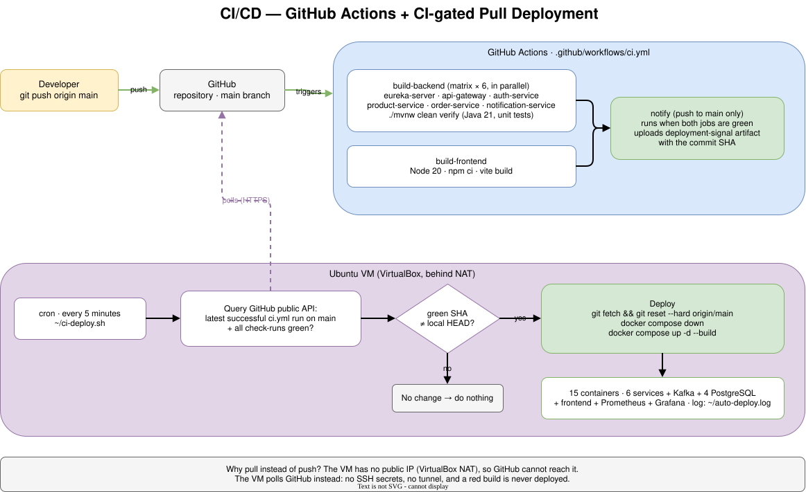

**GitHub Actions** runs on every push to `main`: builds all 6 Spring Boot services in parallel (matrix strategy), runs unit tests, and builds the frontend. When everything is green, a `notify` job publishes a deployment signal artifact.

**Continuous deployment** runs on the deployment VM via a polling script + cron:

- Every 5 minutes, the VM queries GitHub's public API for the latest successful `ci.yml` run on `main`
- If the latest green commit differs from the VM's local `HEAD`, it pulls and runs `docker compose up -d --build`
- If checks are still pending or failing, it skips (CI-gated deployment)

This design works without a public tunnel or SSH secrets — the VM polls GitHub, so the NAT/firewall constraints of a local VirtualBox deployment are irrelevant.

| Component     | File                       | Purpose                                         |
| ------------- | -------------------------- | ----------------------------------------------- |
| CI workflow   | `.github/workflows/ci.yml` | Matrix build + tests + deployment signal        |
| Deploy script | `~/ci-deploy.sh` (on VM)   | Polls GitHub, verifies checks, deploys on green |
| Cron entry    | `crontab -l` on VM         | Runs deploy script every 5 minutes              |

**Note:** This is a recreate deployment (short downtime during each deploy). For zero-downtime, blue-green deployment would be the next step.

---

## 🔐 Authentication & Authorization

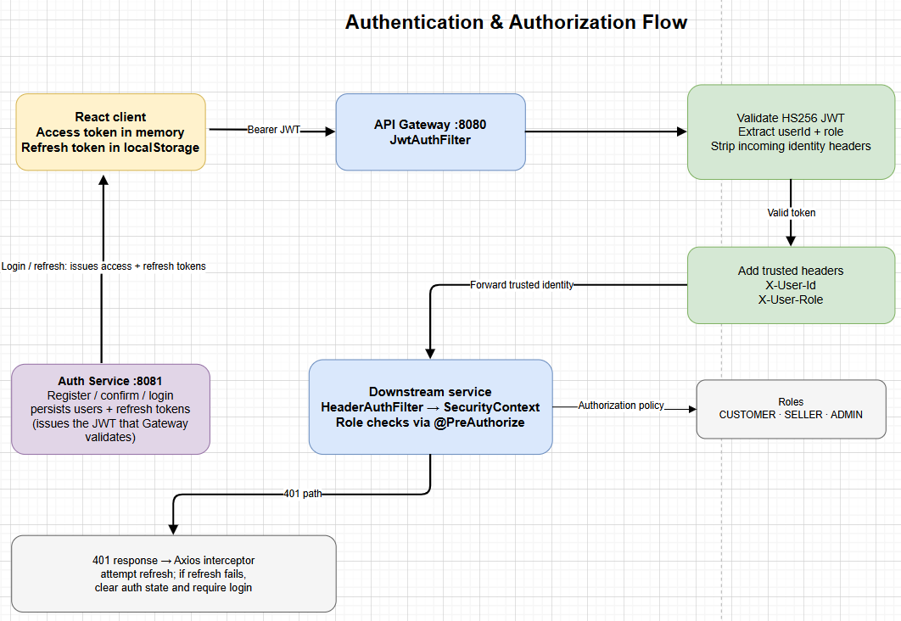

**JWT validated at the API Gateway** — single point of auth.

### Flow

1. Browser → Gateway with `Authorization: Bearer JWT`
2. Gateway's JwtAuthFilter:
   - Skips public paths: `/api/auth/register`, `/login`, `/confirm`, `/refresh`, `/logout`
   - Validates JWT signature (HS256)
   - Extracts userId and role
   - Strips any incoming `X-User-Id`/`X-User-Role` headers (anti-spoofing)
   - Adds trusted `X-User-Id` and `X-User-Role` headers downstream
3. Services trust these headers via HeaderAuthFilter → Spring Security context
4. `@PreAuthorize("hasRole('SELLER')")` enforced at service level; notification-service rejects any request without the gateway headers already in its `SecurityFilterChain` (403)

### Roles

| Role         | Permissions                                                                                                      |
| ------------ | ---------------------------------------------------------------------------------------------------------------- |
| **CUSTOMER** | Browse products, place orders, view own orders                                                                   |
| **SELLER**   | Manage own products, view incoming orders, update statuses, receive low-stock / sold-out alerts (in-app + email) |
| **ADMIN**    | Manage all users, products, orders                                                                               |

### Registration

1. POST /auth/register → save user (enabled=false) → send confirmation email
2. User clicks link in email → POST /auth/confirm → enabled=true → `user-registered` event published to Kafka (after commit)
3. Only enabled users can log in

### Tokens

- Access token: 15 min (dev: 1h via local profile override)
- Refresh token: 7 days
- Access token in memory (React state)
- Refresh token in localStorage
- Axios interceptor auto-refreshes on 401

---

## 🗄️ Data Model

### auth-service

- `users` (id, email, password, role, enabled, timestamps)
- `confirmation_tokens` (id, token, user_id, expires_at, confirmed_at)
- `refresh_tokens` (id, token, user_id, expires_at, revoked)

### product-service

- `products` (id, name, description, price, stock, category, image_url, seller_id, active, timestamps)
- **Soft delete** via `active=false`
- Indexes on `seller_id`, `category`, `name`, `active`

### order-service

- `orders` (id, customer_id, total_price, status, timestamps)
- `order_items` (id, order_id FK, product_id, product_name, product_image, seller_id, unit_price, quantity, subtotal)
- **Snapshot pattern**: order items store product data at order time
- **State machine**: PENDING → CONFIRMED → SHIPPED → DELIVERED; PENDING → CANCELLED when stock cannot be reserved

### product-service / notification-service (Kafka consumers)

- `processed_event` (event_id, processed_at) — idempotency: every consumed event is processed at most once

### notification-service

- `notifications` (id, user_id, type, title, message, product_id, is_read, created_at) — index on (user_id, is_read)
- `user_contact` (user_id, email, role, updated_at) — local copy of contact data, filled from Kafka

---

## 📨 Event-Driven Communication (Apache Kafka)

Stock handling used to be a synchronous OpenFeign call (`PATCH /products/{id}/stock`) after an order was saved: if product-service was down, the stock was never decremented. It is now an **asynchronous, event-driven flow** over Apache Kafka (single broker in **KRaft mode**, no Zookeeper). OpenFeign remains only for one read: `GET /products/{id}` to validate price and stock while the order is built.

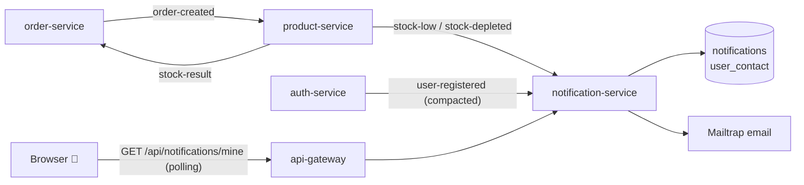

| Topic             | Producer → Consumer                    | Key       | Meaning                                                              |
| ----------------- | -------------------------------------- | --------- | -------------------------------------------------------------------- |
| `order-created`   | order-service → product-service        | orderId   | An order was saved; reserve its stock                                |
| `stock-result`    | product-service → order-service        | orderId   | Reserved or rejected (with reason); rejected orders become CANCELLED |
| `stock-low`       | product-service → notification-service | productId | Stock crossed the threshold (above 3 → 1..3), rung once per crossing |
| `stock-depleted`  | product-service → notification-service | productId | Stock reached 0                                                      |
| `user-registered` | auth-service → notification-service    | userId    | A user confirmed their email; **compacted** topic (latest per user)  |
| `<topic>-dlt`     | any consumer → (people, replay)         | same key  | Dead-letter topics: messages that failed, with the error in headers  |

### Order flow

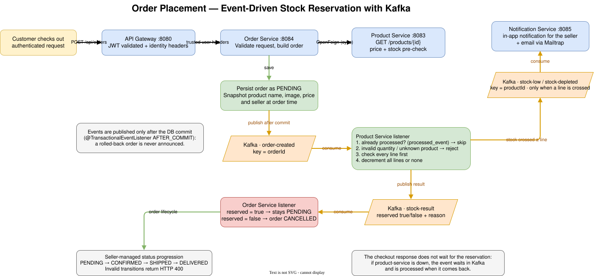

1. `POST /api/orders` → order-service saves the order as **PENDING** and publishes `order-created` **after the DB commit** (`@TransactionalEventListener(AFTER_COMMIT)`), so a rolled-back order is never announced.
2. product-service checks **every line first**, then decrements all of them or none, and replies on `stock-result`.
3. order-service cancels the order if the reservation was rejected.

### Reliability & safety patterns

- **Publish after commit**: events are sent only once the database transaction has committed.
- **Idempotent consumers**: a `processed_event` table (Flyway-managed) makes redelivered events harmless; contact upserts by primary key are naturally idempotent.
- **Ordering by key**: messages are keyed by `orderId` / `productId` / `userId`, so events about one entity stay in order within their partition.
- **Event-carried state transfer**: notification-service keeps its own `user_contact` table instead of calling auth-service, so emails keep working when auth-service is down.
- **Defense in depth**: consumers validate every event (e.g. quantity must be > 0) and never trust a message blindly; the external Kafka listener is bound to `127.0.0.1` only.
- **Best-effort side effects**: the in-app notification is saved first; a failing email is logged and never breaks event processing.
- **Retries with exponential backoff**: a failing message is retried after 1 s, 2 s and 4 s, so short outages (e.g. a database restart) heal by themselves.
- **Dead-letter topics**: after the last retry, the message is parked in `<topic>-dlt` (same partition, exception details in the headers) instead of being lost. Once the cause is fixed, it can be replayed to the original topic; idempotent consumers make the replay safe.
- **Poison-pill protection**: an `ErrorHandlingDeserializer` wraps the JSON deserializer, so unreadable messages go to the DLT instead of blocking their partition forever.
- **Permanent vs. temporary errors**: invalid events (e.g. missing `eventId`) raise `InvalidEventException`, which is marked non-retryable and goes straight to the DLT.

The remaining synchronous Feign call forwards `X-User-Id`/`X-User-Role` through `FeignConfig.RequestInterceptor` (OpenFeign + Apache HC5).

---

## 🛠️ Tech Stack

**Backend**

- Java 21
- Spring Boot 4.1.1
- Spring Cloud 2025.1.3 (Eureka, Gateway, OpenFeign)
- Spring Security 6 + JWT (JJWT 0.12.6)
- Spring Data JPA + Hibernate
- Flyway migrations
- MapStruct 1.6.3
- PostgreSQL 16
- Lombok
- OpenFeign + Apache HC5
- Apache Kafka 3.9 (KRaft) + Spring for Apache Kafka
- Spring Mail (Mailtrap sandbox)

**Frontend**

- React 18 + Vite 8
- React Router v6
- Axios (interceptors for JWT + auto-refresh)
- TailwindCSS 3
- Context API (AuthContext, CartContext)
- Notification bell with unread badge (polls every 30 s)

**Infrastructure**

- Docker + Docker Compose
- Nginx (frontend serving + reverse proxy)
- Multi-stage Docker builds (JDK → JRE)
- Prometheus + Micrometer
- Grafana

---

## 📁 Project Structure

```
kh-ecommerce-microservices/
├── docker-compose.yaml
├── .env.example
├── .github/workflows/ci.yml
├── README.md
├── api-gateway/
├── auth-service/
├── product-service/
├── order-service/
├── notification-service/
├── eureka-server/
├── frontend/
├── prometheus/
├── grafana/
└── docs/
    ├── diagrams/
    └── screenshots/
```

---

## 🌐 API Endpoints

### Auth

- `POST /api/auth/register`
- `POST /api/auth/confirm`
- `POST /api/auth/login`
- `POST /api/auth/refresh`
- `POST /api/auth/logout`

### Products

- `GET /api/products` — list (public)
- `GET /api/products/{id}` — detail (public)
- `GET /api/products/search?q=` — search (public)
- `GET /api/products/mine` — seller's products (SELLER)
- `POST /api/products` — create (SELLER)
- `PUT /api/products/{id}` — update (SELLER, owns)
- `PATCH /api/products/{id}/stock` — adjust stock (internal; order placement no longer uses it, stock changes through Kafka)
- `DELETE /api/products/{id}` — soft delete (SELLER, owns)

### Orders

- `POST /api/orders` — place order (CUSTOMER)
- `GET /api/orders/mine` — customer's orders (CUSTOMER)
- `GET /api/orders/seller` — incoming orders (SELLER)
- `GET /api/orders/{id}` — detail (auth, ownership checked)
- `PATCH /api/orders/{id}/status` — update status (SELLER)

### Notifications

The user id always comes from the gateway's trusted `X-User-Id` header, never from the URL.

- `GET /api/notifications/mine` — my notifications, newest first (auth)
- `GET /api/notifications/mine/unread-count` — unread count for the navbar bell (auth)
- `PATCH /api/notifications/{id}/read` — mark one as read (auth, own only; others answer 404)
- `PATCH /api/notifications/mine/read-all` — mark all as read (auth)

---

## 🎓 Design Decisions

1. **JWT validated at the edge** — single point of auth; downstream services trust headers
2. **Anti-header-spoofing** — Gateway strips and re-adds identity headers
3. **Database-per-service** — no shared schema, each service owns its data
4. **Soft delete** — `active=false` preserves referential integrity
5. **Snapshot pattern** — order items keep original product data
6. **Best-effort side effects** — email failures don't break core flows
7. **Guest cart** — no login needed to add to cart; login enforced at checkout
8. **Return-to-login flow** — post-login redirect back to intended page
9. **Multi-stage Docker builds** — small runtime images (JRE only)
10. **12-factor secrets** — env vars in Docker, gitignored local configs in dev
11. **Provisioned observability** — Prometheus scrape config and Grafana datasource are committed as files
12. **CI-gated deployment** — VM polls GitHub for green commits; never deploys red
13. **Events instead of synchronous calls** — order and stock services no longer need each other to be up at the same time; order placement is a small choreography saga (reserve stock, or cancel the order)
14. **Idempotent consumers** — Kafka delivers at least once, so every consumer tolerates duplicates
15. **Compacted topic as a lookup table** — `user-registered` keeps the latest contact per user, so a consumer can rebuild its copy from the beginning
16. **Threshold crossing, not level** — stock alerts fire once when crossing a line, not on every sale below it

---

## 🚧 Roadmap

- [x] Prometheus + Grafana observability
- [x] CI/CD pipeline (GitHub Actions + auto-deploy to Ubuntu VM)
- [x] Kafka event bus + notification-service (in-app + email stock alerts)
- [x] Choreography saga for order placement (reserve stock or cancel the order)
- [x] Kafka retries with exponential backoff + dead-letter topics
- [ ] Transactional outbox (no lost event if Kafka is unreachable right after a commit)
- [ ] Public URL / cloud deployment (Oracle Cloud free tier)
- [ ] Kafka security (SASL authentication + ACLs)
- [ ] Push notifications (WebSocket / Server-Sent Events) instead of polling
- [ ] Admin panel
- [ ] Image upload (S3)
- [ ] Advanced filters (price range, category)
- [ ] Refresh token rotation
- [ ] Blue-green deployment (zero-downtime)

---

## 👤 Author

**Khaldoun Damach**

- GitHub: [@KhaldounDamach2](https://github.com/KhaldounDamach2)
